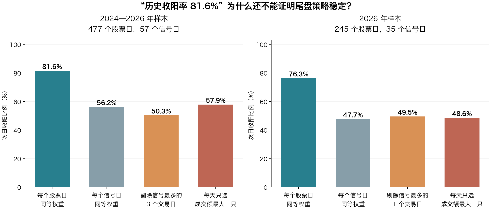

# 七日深跌后尾盘买入：条件组合与高胜率核验

研究于 2026-10-24 开始，2026-10-25 整理。本地数据截至 2026-10-22；未补拉 10-23 行情。

## 结论先行

可以筛出历史次日收阳率超过 80% 的组合，但本轮没有找到足够证据将它认定为稳定的高胜率尾盘策略。

最值得保留观察的是：**前一天已经七日深跌且振幅较大，今天继续收较大阴线，尾盘以收盘价为代理入场**。基础候选 D4 的历史次日收阳率为 **389/477＝81.55%**，扣除假设成本后、按次日收盘退出的盈利率为 **364/477＝76.31%**。但它严重依赖少数信号密集日：去掉信号最多的三个交易日，收阳率降至 **73/145＝50.34%**。

因此，以下条件是可复查的研究候选，不是已通过未来样本验证的实盘规则。把阴线门槛继续收紧，可以提高股票样本的历史百分比，却没有解决按日期统计的稳定性问题。



## 一、先把“成功”说清楚

设 T 为准备尾盘买入的交易日，O/C/H/L 分别为开盘、收盘、最高、最低价。

| 指标 | 定义 | 能说明什么 |
|---|---|---|
| 次日收阳 | C(T+1)>O(T+1) | 次日 K 线是阳线 |
| 次日阳线实体>2.5% | C(T+1)/O(T+1)−1>2.5% | 次日出现较大阳线 |
| 尾盘买入后毛收益 | C(T+1)/C(T)−1 | 理想化收盘买、次日收盘卖的价格收益 |
| 扣费盈利 | 上项收益减去 0.15 个百分点后>0 | 在统一成本假设下的收盘收益 |
| 次日最高价触及目标 | H(T+1)达到按分向上取整的买入价×1.025 | 曾有价格机会，不等于可按目标成交 |

本报告的成本是研究假设，不是某家券商费率报价。另做了总成本 0.10%、0.20%、0.30% 的敏感性计算。

次日收阳可能仍然亏钱。候选中的翔鹭钨业，2024-02-05 收盘 5.10 元，次日开盘 4.61 元、收盘 4.64 元。次日确实收阳，但从前一日收盘买入到次日收盘，扣除上述成本仍约亏 **9.17%**。D4 全期有 33 例“次日收阳但扣费不盈利”。

如果用户所说的“阳线”实际要求实体>2.5%，D4 对应比例只有 **69.81%**，不能用 81.55% 替代。

## 二、样本与旧规则

当前共享 GOB 中有 1,302,711 根日线、1,956 个有日线记录的代码；主要股票元数据为 1,932 只，另有历次股池补入代码。范围为 2024-01-02 至 2026-10-22。主体是当前快照下流通市值至少 50 亿元的沪深主板股票。

这不是当时完整的 A 股可投资股票池。主股票池的市值快照是 2026-10-23，只有 8 个日期保存了单日股票池，不能宣称历史上每一笔都满足当时流通市值门槛。当前股票名称排除 ST/退市标记，也不能还原所有历史风险警示状态。结果可能受存续股票、当前市值选样等偏差影响。

原“七日深跌 v3”是：

1. T−1 收盘/T−7 收盘−1≤−22.25%。
2. T−1 振幅≥7.1%，以前一交易日收盘为分母。
3. T−1 收盘位置≤80%。
4. T 日开盘缺口位于 [−4%,−2%)。
5. 原统计分别观察 T、T+1 阳线实体是否>2.5%，以及两天任一天达标。

这里七根日线的首尾只有六个收盘收益间隔，**不是连续七天收跌，也不是严格的七个交易日累计收益**。本轮沿用此定义以便与旧规则比较，并单列严格七个收益间隔的敏感性检验。

原“两天任一天达标”比例不能移植为“尾盘买入、次日收阳或盈利”的胜率。

## 三、日线数据处理与交易假设

- 按代码、日期排序并去重；要求有效 OHLC、成交量>0、主板代码、至少已有 20 根本地日线，历史窗口逐交易日对齐。
- 次日指市场日历中的下一交易日。缺失下一交易日价格的样本排除，不当作失败，也不跳过停牌去寻找更远的一天。
- 排除已知无法按显示价格假设买入的一字涨停；跌停收盘没有统一排除，另做回避近跌停的敏感性检验。
- 数据源的主要 THS 请求使用 `adjust_type=actual`，是不复权价格。为避免送转除权或异常断层伪造“超跌”，在入场当天可观察的最近 8 根日线中，若出现单日收盘变动绝对值>11%，先隔离该候选；另外检查 14 根窗口。
- 这是一项保守的数据质量隔离，不能替代逐笔核对公司行动与复权因子。没有根据次日盈亏删除样本。
- 用 T 日最终收盘价作为尾盘买价代理，T+1 收盘作为退出参考。未假设盘中止盈或止损成交。
- 最终收盘价、收盘位置和全天成交量在 14:50 尚未确定。基于它们筛选后又按同一收盘价买入，是理想化代理，不能声称消除了执行时的信息偏差。
- 本地只有 8 份个股分时缓存，D4 的 477 个候选与之重叠为 **0**，所以本轮没有验证真正的 14:50/14:55 买点、滑点、尾盘信号保持率和次日卖出执行。
- 对次日一字跌停仍按收盘记账并另行标记；这种账面收益不是保证能够退出的成交收益。D4 中未出现该标记，其他基线有此情形。

## 四、先比较三种买法

以下均采用上述数据隔离与 0.15% 成本假设，年份分段是描述性检验。

| 买法 | 2026 样本数/信号日 | 次日收阳率 | 次日收盘扣费盈利率 | 平均每笔扣费收益 |
|---|---:|---:|---:|---:|
| 深跌当天直接尾盘买：T 收盘/T−6 收盘−1≤−22.25% | 1,749/140 | 51.86% | 50.31% | −0.09% |
| 原 v3 低开确认后改到 T 日尾盘买 | 75/29 | 45.33% | 41.33% | −0.46% |
| 前一天深跌且满足振幅、位置，T 日收阴后尾盘买，不限 T 日开盘缺口 | 423/65 | 61.23% | 61.94% | +1.51% |

第一种没有显示出足够的高成功率优势。第二种把原本低开入场的反弹利润留在日内，等尾盘再进，不能沿用原策略表现。第三种有继续研究的价值，但还需要判断这种优势是否集中于少数日期。

## 五、可复查的条件组合 D4

这组是本轮探索后的候选，参数不是未看结果前锁定的最终策略。

**观察范围**：上述本地主板样本；交易时还需用当时可见的风险警示、流动性与公司行动数据复核。

**T 日尾盘候选条件**：

1. `C(T−1)/C(T−7)−1 ≤ −22.25%`。
2. `(H(T−1)−L(T−1))/C(T−2) ≥ 7.1%`。
3. `(C(T−1)−L(T−1))/(H(T−1)−L(T−1)) ≤ 80%`，且振幅非零。
4. `C(T)/O(T)−1 < −4%`，严格小于，不包含恰好 −4%。
5. 最近 8 根日线没有单日收盘涨跌绝对值>11%的价格断层；满足前述连续性和数据完整性要求。
6. 以 T 收盘价作入场代理，观察 T+1 收盘。**不再要求 T 日低开 2%～4%，不额外要求近七日涨停，也没有偷偷增加成交额门槛。**

直观含义是：先前深跌后仍出现一次明显日内杀跌，再观察隔日修复。这是对当前样本的解释，尚不能证明卖压已经衰竭。

| 年份 | 股票日/信号日 | 次日收阳率 | 次日实体>2.5% | 扣费盈利率 |
|---|---:|---:|---:|---:|
| 2024 | 221/12 | 87.78% | 79.19% | 75.57% |
| 2025 | 11/10 | 72.73% | 9.09% | 45.45% |
| 2026 | 245/35 | 76.33% | 64.08% | 78.37% |
| 全期 | 477/57 | **81.55%** | **69.81%** | **76.31%** |

全期最差单笔参考收益为 **−10.20%**，约 **13.00%** 的样本扣费亏损达到 5%。这些是收盘参考收益，未模拟止损成交。

把第 4 条收紧到实体 `<−6%`，全期变为 355 例/32 日：收阳 **85.35%**，扣费盈利 **78.87%**；2026 为 181 例/21 日：收阳 **81.77%**，扣费盈利 **84.53%**。这个版本的日期集中程度更高，不能因此认定更可靠。

## 补充：次日收盘盈利严格超过 2.5%（2026-10-25）

这里的收益从 T 日收盘入场代理价计算，分母是买价；与次日阳线实体的分母（次日开盘价）不同，也没有用次日最高价代替收盘价。恰好 2.5% 不计入。

- 毛收益超过 2.5%：`(T+1收盘/T收盘−1)×100% > 2.5%`。
- 扣费后超过 2.5%：上项减去假设总成本 0.15 个百分点后，仍严格大于 2.5%；对应毛收益严格大于 2.65%。

D4（当天阴线实体>4%）结果：

| 年份 | 样本数 | 毛收益>2.5%：数量/比例 | 扣费后收益>2.5%：数量/比例 |
|---|---:|---:|---:|
| 2024 | 221 | 150 / 67.87% | 150 / 67.87% |
| 2025 | 11 | 2 / 18.18% | 2 / 18.18% |
| 2026 | 245 | 165 / 67.35% | 163 / 66.53% |
| 全期 | 477 | **317 / 66.46%** | **315 / 66.04%** |

当天阴线实体>6%的收紧版：全期355例，毛收益>2.5%为251/355＝70.70%，扣费后为250/355＝70.42%；2026年181例，毛收益>2.5%为139/181＝76.80%，扣费后为138/181＝76.24%。它仍受前述日期集中影响，不能视作独立验证。

D4剔除信号最多的三个交易日后，剩余145例：毛收益>2.5%为49/145＝33.79%，扣费后为48/145＝33.10%。2026剔除信号最多的一个交易日后，剩余109例：毛收益>2.5%为39/109＝35.78%，扣费后为38/109＝34.86%。

各组统计已补入 `results.csv`、`results.json`、`robustness.csv`、`robustness.json`，并另存 `次日收盘盈利超过2.5统计.csv`。

## 六、为什么没有把它宣布为高胜率策略

### 1. 三个交易日占了近七成样本

D4 的三个最大信号日为：

| 入场日期 | 当天候选数 | 次日收阳率 | 次日收盘扣费盈利率 |
|---|---:|---:|---:|
| 2026-07-20 | 136 | 97.79% | 97.79% |
| 2024-02-07 | 105 | 100.00% | 100.00% |
| 2024-02-05 | 91 | 85.71% | 56.04% |

三天合计 332/477＝69.60%。剔除这三天，剩余 145 例、54 个交易日：收阳 **50.34%**，扣费盈利 **51.72%**，平均每笔扣费收益 **−0.93%**。

2026 单独看，2026-07-20 一天占 136/245＝55.51%；剔除这一天，剩余 109 例、34 日：收阳 **49.54%**，扣费盈利 **54.13%**，平均扣费收益 **−0.78%**。

这些反弹日确实发生在样本中，不能因为集中就把它们从正式历史统计中抹掉；剔除只是压力测试，说明结果高度依赖少数事件。单日上百只同涨不能当作上百次独立验证。

### 2. 每天相同总仓位，结果明显不同

股票日同等权重会给信号密集日更大权重。如果每天投入相同总仓位、在当天候选中等权分配，更相关的是先算当日组合收益，再对信号日同等权重。

| D4 统计方式 | 全期 | 2026 |
|---|---:|---:|
| 每个股票日同等权重：次日收阳率 | 81.55% | 76.33% |
| 每个信号日同等权重：日内候选平均收阳比例 | 56.21% | 47.67% |
| 每日等权候选组合的盈利日比例 | 50.88% | 48.57% |
| 每个信号日同等权重的组合平均扣费收益 | −0.18% | −0.54% |
| 每天只选成交额最大一只：次日收阳率 | 57.89% | 48.57% |
| 每天只选成交额最大一只：扣费盈利率 | 54.39% | 51.43% |

“每日候选平均收阳比例”与“组合盈利日比例”是不同指标，不能互换。若每只股票投入固定金额、信号越多总仓位越高，权重会再次变化；必须先规定总仓位上限与当日选股数，才能讨论账户表现。本报告不把股票日平均收益当作账户收益或年化收益。

### 3. 加条件能继续做高百分比，但没有增加独立事件

| 在 D4 上追加条件 | 全期样本/日期 | 次日收阳率 | 2026 样本/日期 | 次日收阳率 |
|---|---:|---:|---:|---:|
| 无追加 | 477/57 | 81.55% | 245/35 | 76.33% |
| 当日样本池上涨家数占比≥50% | 282/20 | 89.01% | 166/13 | 86.14% |
| 同日 D4 信号至少 20 只 | 332/3 | 95.18% | 136/1 | 97.79% |

上涨家数占比来自当前可用主板样本池，不是全市场广度。追加≥50%后，2026 按信号日同等权重的平均收阳比例仍只有 **49.28%**。同日信号至少20只的“95%”，其实只有三个入场日期，2026 更只有一天。没有把这些百分比选作推荐结论。

加入成交额≥3亿、≥5亿、回避接近跌停、延长价格断层隔离窗口，以及改用严格七个收益间隔，也没有解决日期稳定性问题。详情见 `robustness.csv`。

### 4. 不确定性比单一百分比大得多

按信号日整组抽样、保留同一天所有股票的 10,000 次重采样，D4 全期股票日收阳率的描述性 95% 区间约 **52.38%～90.79%**；按日期同等权重的平均收阳比例区间约 **43.78%～68.33%**。

这种重采样也不能消除相邻日期相关性、选样偏差与调参偏差，因此这些区间不能用作未来胜率保证。它们说明把点估计“81.55%”当成稳定能力并不充分。

## 七、旧版样本与同期对照

从 Git LFS 本地保存的旧快照重算 D4：旧版生成于 2026-10-21，数据截至 2026-10-20。新旧主体股票池均为 1,932 只；共同可评价区间内 D4 均为 477 例、57 个信号日，入选成员一致，入场收盘价和次日阳线标签无差异。当前新增数据没有增加 D4 样本。

这说明本轮发现不依赖这次缓存更新；但新旧快照大量重叠，不构成两份独立验证。旧文档的原 v3 样本数量也不能与本轮 D4 混用：入场、筛选、数据隔离与评价目标均不同。

另以相同信号日期的可用主板日线作粗略对照：全期日期同等权重下，D4 平均收阳比例 56.21%，同期可用股票池为 52.64%；2026 为 D4 47.67%，同期股票池 49.64%。这是未做行业、市值、风险状态配对的描述性对照，不能证明因果优势。

## 八、这次研究能交付什么，不能确认什么

**能交付**：明确条件、完整候选明细、分年结果、成本敏感性、集中度检验、新旧快照对照、价格断层隔离，以及次日阳线和交易收益的独立统计。

**尚不能确认**：稳定≥80%的未来收阳或盈利率；14:50/14:55实际可执行的买点；真实成交滑点与次日退出路径；历史完整股票池上的有效性。

初轮比较了三个入场定义×16个条件组，共48种组合，随后查看了阴线实体阈值及少量诊断条件。2026 数据既参与过此前项目研究，也被本轮查看并用于探索，因此**所有结果均属于探索性历史研究**，不能称为未见样本或严格样本外验证。

如果继续验证，应冻结 D4 与 `<−6%` 两个版本，同时锁定买入时点、每次候选排序、每日总仓位、卖出方式。先补齐候选日期的分钟数据和公司行动，再记录之后新出现的独立信号日期。不能在新增样本失效时继续修改条件、仍把原来的 80% 当作证据。

本轮判断是：**“七日深跌＋再收较大阴线”值得保留为修复观察形态；现有样本支持它在部分集体反弹日表现很强，尚不支持将其定义为日常稳定的高胜率尾盘策略。**

## 九、本地文件与复算

- `candidate-minus4-samples.csv`：D4 完整 477 个股票日。
- `original-v3-close-samples.csv`：初轮原 v3 改为收盘入场的明细，尚未进行价格断层隔离；不要与最终表混用。
- `results.csv` / `results.json`：初轮48组合及基础跌幅敏感性，尚未进行价格断层隔离。
- `robustness.csv` / `robustness.json`：最终隔离后的统计；JSON含按日压力测试、成本敏感性及重采样区间。
- `D_body_lt_-4-all-days.csv` / `D_body_lt_-4-2026-days.csv`：信号日分布。
- `old-new-comparison.json`：新旧快照核对结果。
- `matched-date-comparison.json`：同期可用股票池粗略对照。
- `minute-coverage.json`：分时缓存覆盖检查。
- `data-audit.json`：样本范围与来源审计。
- `green-candle-but-loss-examples.csv`：次日收阳仍亏损的样本。
- 研究脚本在 `scripts/research/oversold-close-20261024/`，没有接入应用选股或修改生产策略。

从项目根执行，所需 Python 包为 numpy、pandas、matplotlib：

```bash
mkdir -p /tmp/go-stock-oversold-20261024
go run scripts/research/oversold-close-20261024/export_gob.go backend/data/cache/mainboard_floatcap50_2024/daily.gob /tmp/go-stock-oversold-20261024/daily.csv.gz /tmp/go-stock-oversold-20261024/metadata.json
python3 scripts/research/oversold-close-20261024/analyze.py
python3 scripts/research/oversold-close-20261024/robustness.py
python3 scripts/research/oversold-close-20261024/chart.py
```

最后两份原始导出位于临时目录，最终特征、结果和报告保存在本地项目中。若原 GOB 后续更新，重新导出会得到新的研究版本，应保留当时快照再比较。

交易时点参考：[上海证券交易所交易规则（2026年修订）](https://www.sse.com.cn/lawandrules/sselawsrules2025/trade/universal/c/c_20260424_10816492.shtml)及[深交所主板股票交易机制说明](https://investor.szse.cn/institute/rules/t20230629_601434.html)。沪深竞价交易的14:57—15:00属于收盘集合竞价。知道15:00最终日线后再筛选，与14:50真实下单可用的信息不同。
