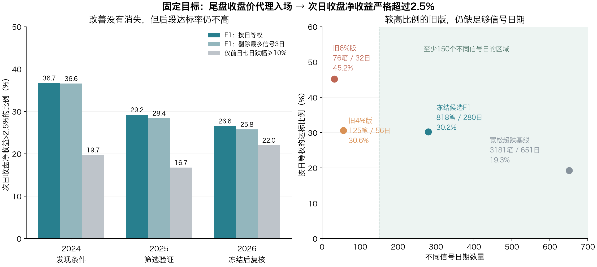

# 尾盘买入、次日收盘净赚超过2.5%：条件组合优化

研究日期：2026-10-25。日线快照截至2026-10-22，未补拉10-23日线。目标与上一轮补充一致：

`净收益 = (下一交易日收盘价 / 买入参考价 − 1) × 100% − 0.15%`

成功要求净收益**严格大于2.5%**。成本0.15%是统一研究假设。没有把次日收阳、盘中触及目标或恰好赚2.5%当成成功。

## 研究结论

本轮**没有找到同时具有高达标率、足够样本、较低日期集中度和稳定正收益的条件组合**。

在事先规定每天最多5只、按交易日等权评价、先用2024发现条件和2025筛选、冻结后复核2026的流程下，相对最值得保留的候选F1有818笔、280个不同信号日：

- 次日收盘扣费后赚超2.5%：255/818＝**31.17%**。
- 按信号日等权的平均达标比例：**30.21%**；剔除信号最多的三个交易日后为**29.75%**，不再由那三个日期主导。
- 2026年：133/458＝**29.04%**，按日等权为**26.56%**，按日平均净收益**−0.39%**，未通过年份稳定性检查。
- 补齐F1全部818份历史分时后，对这批固定样本用14:50价格重估，达标为246/818＝**30.07%**；2026为132/458＝**28.82%**。买入价换成实际尾盘价格，并没有扭转已选样本的表现。

F1提高了宽松超跌池的历史达标比例，但还不是值得据此采用的高成功率策略。其他两套冻结候选的2026结果更弱。



## 一、这轮如何约束“优化”

研究开始前已写入《研究约定.md》，而不是看结果后才决定哪些检查算数。

### 样本和日期要求

- 最终候选合计至少500个**实际所选股票日**、150个不同信号日期。
- 2026年单独至少100个所选股票日、40个不同信号日期。
- 每天最多5只，按当日成交额由大到小选，代码为并列次序。这个上限是明确的选股执行规则，不是只在统计时给密集日缩权。
- 同时披露不限制数量的原始候选、每天只选1只、同股至少间隔5个交易日的结果。
- 剔除每套规则信号最多的三个交易日，以及上一轮已知的2024-02-05、2024-02-07、2026-07-20，分别做压力测试；正式统计保留这些实际日期。

本报告的“不同信号日”不等于统计上完全独立：相邻交易日、相同股票仍可能相关，因此另外使用连续5个市场交易日为块的重采样。

### 搜索和时间隔离

1. 根条件为截至T日或T−1的严格七个收盘收益间隔，跌幅至少10%、15%、20%，共6种。
2. 预定义69项日线条件，涉及实体、开盘缺口、振幅、收盘位置、下影、量比、成交额、前日状态、RSI、均线乖离、涨停记忆、低点承接、样本池广度等。
3. 根条件最多再加3组条件，同类指标不重复叠加。使用有限宽度逐层搜索，不是穷举全部可能策略。
4. 2024训练期要求至少180笔、60个信号日，评分同时考虑按日达标、剔除密集日后的表现、抽样波动及条件复杂度。
5. 共尝试7,708个条件表达，3,283个不同训练样本掩码满足训练规模要求。先保存40个分散的训练候选，另加6个根条件作对照，再查看2025。
6. 2025至少100笔、40日，且训练与验证按日平均净收益都为正的有6套；按训练/验证较弱一段的评分、条件简洁性和预测差异，冻结3套。
7. 冻结文件保存后才复核2026，未依据2026表现重调阈值。冻结文件哈希在最终核验中保持一致。

**2026此前已在项目研究中被查看，本轮也承接此前结论，所以不能把本轮时间隔离称为全新、严格未见的样本外验证。** 7,708次尝试也意味着训练期最优数字有选择偏差；不能把评分使用的误差项当成已校正的未来置信保证。

## 二、数据处理

沿用上一轮已导出的共享日线快照，原始1,302,711根、1,956个代码。主体股票池来自当前快照，存在历史市值选样、存续股票和风险警示状态不完整的问题。

本轮最长特征使用20日前数据，因此要求21根日线逐市场交易日连续，且这一窗口没有单日收盘涨跌绝对值>11%的价格断层。继续要求有效OHLC、主板代码、成交量>0、已验证成交额、排除当前名称中的ST/退标记和一字涨停买入假设。

纳入宽松超跌研究范围并有紧邻下一交易日有效价格的样本共94,302个股票日、1,882个代码：2024年30,952条，2025年23,567条，2026年39,783条。它们是**用于筛条件的候选范围**，不是最终交易数。

THS主要日线为不复权价格。若T+1出现绝对值>11%的收盘跳变，缺少公司行动核验时保留分母、标记未确认，不用于宣称成功；研究范围内有19个这样的标签。冻结三套实际所选样本中均为0个。该标记不参与买入条件，不能把次日涨跌拿来筛买点。

年度边界上，跨到下一年才产生结果的入场日从时间分段中隔离，避免前段使用后段标签。正式比较的全期是这些年度可评价样本的合并。

现有股池的涨跌家数比例只是**可用样本池广度**，不是完整全市场广度。数据缺失、停牌跨日不跳过，也不当成失败。

## 三、最终冻结的三套条件

下文T为准备买入的当天，C/O/H/L分别为收盘/开盘/最高/最低。日线研究用T最终收盘价作为尾盘买入参考价；最终日线筛选和成交额排名在14:50尚未确定，其执行局限另见分时复核。

### F1：前日已跌、当日高振幅、低RSI、量能适中

1. `C(T−1)/C(T−8)−1 ≤ −10%`：截至前一天，七个收盘收益间隔累计跌幅至少10%。
2. `(H(T)−L(T))/C(T−1) ≥ 7%`：当日振幅至少7%。
3. 简单6日RSI≤20：过去6个收盘变动的正变动合计U、负变动绝对值合计D，`RSI=100×U/(U+D)`。此处不是Wilder平滑RSI。
4. `0.7 ≤ 当日成交量/前5个交易日平均成交量 < 1.5`。均量不包含当日，成交量单位必须可比。
5. 满足前述公共数据条件后，每天按成交额排序最多选5只。

这组是在较早数据中发现“跌过、波动足够、位置较低、量能不极端”的组合，**没有要求当日必须大阴线，也没有要求次日高开**。其交易解释是研究假设，不能证明当天已完成止跌。

### F2：深跌后当日收阳

`C(T)/C(T−7)−1≤−20%`，当日振幅≥3%，当日收盘>开盘；公共数据条件和每天最多5只相同。

### F3：更深超跌、振幅、低RSI与量比

`C(T)/C(T−7)−1≤−20%`，当日振幅≥5%，简单6日RSI≤20，量比位于[0.7,1.5)；公共数据条件和每天最多5只相同。

## 四、整体结果

所有达标比例均为**次日收盘扣除0.15%成本后，盈利严格超过2.5%**。

| 候选 | 所选股票日/不同日期 | 达标数量 | 每笔达标率 | 按日等权达标比例 | 剔除信号最多3日后的按日比例 |
|---|---:|---:|---:|---:|---:|
| F1 | 818/280 | 255 | **31.17%** | **30.21%** | **29.75%** |
| F2 | 710/275 | 199 | 28.03% | 27.23% | 27.09% |
| F3 | 773/265 | 223 | 28.85% | 28.73% | 28.22% |

“按日等权达标比例”是先算每天所选股票的成功比例，再对信号日平均；不是整篮子净赚超过2.5%的日期比例。F1整篮子等权净赚超过2.5%的信号日比例为28.21%。所有收益都是参考价格的研究收益，没有把它们当成账户年化收益。

### F1的年份变化

| 年份 | 笔数/日期 | 达标数 | 每笔达标率 | 按日达标比例 | 剔除3日后 | 按日平均净收益 |
|---|---:|---:|---:|---:|---:|---:|
| 2024 | 203/83 | 77 | 37.93% | 36.71% | 36.58% | +0.52% |
| 2025 | 157/68 | 45 | 28.66% | 29.22% | 28.41% | +0.28% |
| 2026 | 458/129 | 133 | **29.04%** | **26.56%** | **25.77%** | **−0.39%** |
| 合计 | 818/280 | 255 | 31.17% | 30.21% | 29.75% | +0.04% |

2026上半年F1的按日达标比例29.40%、按日平均净收益+0.07%；下半年为22.98%、−0.98%。没有用这个分段结果添加月份或年份过滤器。

### 2026冻结复核对比

| 候选 | 笔数/日期 | 每笔达标率 | 按日达标比例 | 按日平均净收益 | 单笔净亏≥5%的比例 |
|---|---:|---:|---:|---:|---:|
| F1 | 458/129 | 29.04% | 26.56% | −0.39% | 17.03% |
| F2 | 339/114 | 22.42% | 21.23% | −0.85% | 18.58% |
| F3 | 432/124 | 25.00% | 23.62% | −0.49% | 15.97% |

三套都通过样本规模、所选股票日集中度要求，也都提高了各自宽松根条件的分年达标比例；但三套的2026按日平均净收益均为负，未通过年份收益稳定性检查。只优化“赚超2.5%的频率”，可能仍被其余交易的亏损抵消。

## 五、到底提高了多少

与同样每天最多5只的宽松根条件比较：

| 规则 | 全期所选笔数/日期 | 每笔达标率 | 按日达标比例 | 2026按日达标比例 |
|---|---:|---:|---:|---:|
| 仅截至前日七日跌幅≥10% | 3181/651 | 19.08% | 19.29% | 22.02% |
| F1四条件 | 818/280 | 31.17% | 30.21% | 26.56% |

相对整个宽松池，F1全期按日达标比例提高10.92个百分点，2026提高4.55个百分点。但筛选条件同时选择了不同交易日期，需要再做同期比较。

只在F1真正有信号的相同日期，比较“宽松根条件中成交额前5只”和“F1成交额前5只”：

- 全期：根条件按日达标22.00%，F1为30.21%，相差8.21个百分点。
- 2026：根条件24.34%，F1为26.56%，相差**2.22个百分点**。
- 2026连续5个市场交易日分块重采样的描述性95%差值区间约**−3.51至+6.96个百分点**，没有足够证据认为这点改善已经稳定。

同日整个可用股票池的平均达标率更低，但那不是相同风险、行业、市值、流动性的配对组合，不能据此宣称F1有稳定超额收益。

F1的2026按日达标比例，分块重采样描述性95%区间约20.66%～31.87%；这些区间没有校正全部历史选样与多次搜索偏差，也不是未来成功率保证。

## 六、为什么不能与上次66.04%直接比较

上一轮D4的66.04%是把全部477个股票日混在一起统计，信号密集的三个日期占近七成。这一轮明确控制每天实际选择数量。

在本轮共同、较严格的样本清理范围内：

| 旧规则 | 不限数量的原始候选 | 原始达标率 | 每天最多5只后的笔数/日期 | 所选达标率 | 按日达标比例 |
|---|---:|---:|---:|---:|---:|
| 旧D4：当天阴线实体>4% | 473 | 66.17% | 125/56 | 37.60% | 30.63% |
| 旧D6：当天阴线实体>6% | 352 | 70.45% | 76/32 | 51.32% | 45.16% |

473和352与上轮477和355略有差异，是本轮21日历史连续性/价格断层处理和时间边界隔离造成的，完整旧结果保留未覆盖。

旧D6按日比例仍较高，但只有32个信号日、每天限额后76笔，无法通过预先规定的规模要求。F1扩大到280个日期后，没有保住这种高比例。因此不能把本轮包装成“66%进一步优化成更高胜率”；更准确的是展示了**高比例与足够多、足够分散的机会之间的现实取舍**。

## 七、分时数据：实际补齐了什么

通过项目使用的同花顺历史分时接口补齐了F1已选818个股票日的完整分时，每份至少230个价格点，均包含14:50、14:55、15:00。

- 所有时间戳均核对到请求交易日，代码与日期严格匹配。
- 所有15:00价格与本地日线收盘价核对，容差为0.011元。
- 817份有明确“手”单位的样本，进一步交叉检查分时累计成交量与日线成交量；1份原日线单位不明确，只用于价格核对，不用于确认时点量比。
- 历史分钟K线接口在较旧日期存在返回其他日期数据的情况：请求2024-01-30却得到2026-08-21的记录，因此拒绝把这类记录混入回测。历史分时价格点接口的818份日期核验均通过。

对**同一批固定818个日线候选**，仅替换入场参考价：

| 年份 | 固定样本数 | 收盘价代理达标率 | 14:50价格达标率 | 14:55价格达标率 |
|---|---:|---:|---:|---:|
| 2024 | 203 | 37.93% | 73/203＝35.96% | 75/203＝36.95% |
| 2025 | 157 | 28.66% | 41/157＝26.11% | 44/157＝28.03% |
| 2026 | 458 | 29.04% | 132/458＝28.82% | 132/458＝28.82% |
| 合计 | 818 | 31.17% | **246/818＝30.07%** | **251/818＝30.68%** |

这说明把买价替换为实际尾盘价格，并没有让已选样本接近高达标率。

### 这不是完整的14:50策略回测

818个候选仍是根据最终日线和最终成交额排名选出的。要回测真正的14:50策略，还必须包括当时符合条件、后来收盘却不符合条件的股票，以及当时按成交额应进入前5的其他股票。

分时接口返回的是每分钟价格点，不是全部逐笔或每分钟完整OHLC。根据价格点重建的振幅只能作为实际振幅的下界，不能用它不达标就断言真实振幅不达标。

对F1这818个样本，在14:50重算已知RSI和量比，并用价格点振幅作保守核对：

- 540例可确认符合这组分时采样条件。
- 58例在14:50已明确不符合RSI或量比条件，说明最终日线确认信号不能直接当成14:50已知信号。
- 220例因分时采样振幅不足以判断真实振幅，或成交量单位不明，无法确认。

没有把这540例再次筛出来宣布新的高胜率，也没有用14:50与14:55的结果重新选择条件或买入时间。本节只做固定候选的买入价格与信息可用性检查。

## 八、其他稳健性检查

### 仓位代表性和重复信号

F1原始未限额候选4,439例，前三个密集日仍占24.62%；所选818笔在每日上限约束下，前三个最多入选日期占1.83%。因而“低集中度”依赖真正执行每日上限，不能拿掉上限后继续沿用结果。

- F1每天只选成交额最大一只，2026有129笔/129日，达标33例＝25.58%，平均净收益−0.67%。
- 同股入场至少间隔5个交易日，F1在2026保留436笔/124日，达标28.21%、按日平均净收益−0.41%。
- F3增加冷却后2026略好于不冷却，但仍是负的按日平均收益，没有将它改选为最终策略。

### 成本与买入价偏差

F1全期把假设总成本从0.15%减到0.10%，达标率只从31.17%到31.30%；加到0.30%降至30.20%。因此问题主要不是这0.05～0.15个百分点的费用差异。

在收盘代理入场价上额外承受0.20%的买入滑点，F1全期达标率为29.71%，2026为27.51%。这与实际14:50价格重估是两种不同检查，不重复叠加解释。

F1的2026所选样本中有3例次日一字跌停标记；日线收盘只是账面退出参考，不保证可以按该价卖出。本轮没有用日线最高/最低假设盘中止盈止损，也没有模拟完整账户资金周转与成交。

## 九、可以保留与应当停止的部分

**保留F1作为冻结观察候选**：它符合规模要求，对少数密集日不敏感，相对宽松超跌池有一定达标比例提升，且已经留下完整明细与818份历史分时。

**不把F1认定为可采用的高成功率策略**：绝对达标率仍低，2026参考收益为负；相同日期配对后的改善不确定性较大；最终日线选股还没有转成完整时点可用的尾盘选股。

当前数据支持的判断是：在本轮明确的范围、条件和执行代表规则下，继续细调几个日线阈值，没有找到同时满足用户要求的版本。它不是“任何超跌尾盘策略都不可能有效”的证明，也不能因为某个训练结果更高，就继续借已查看的2026数据反复调参。

后续若继续研究，关键数据工作是按固定14:50时点补齐**全部潜在候选**的可用价格、振幅和累计量额，再按当时信息重新筛选与排名，并继续保留未参与调参的新日期。现有818份分时为这个工作提供了起点，但还不能代替它。

## 十、文件、复算与核验

- `研究约定.md`：搜索前的目标、规模与时间分段约定。
- `condition-definitions.json`、`search-settings.json`：全部根条件、原子条件和搜索设置。
- `training-search.csv.gz`、`training-shortlist.json`：训练搜索记录与先行保存的短名单。
- `validation-results.json`、`frozen-candidates.json`：2025筛选结果与冻结的三套条件。
- `evaluation.csv`、`evaluation.json`：三套候选、六个根条件及旧版对照的分期结果。
- `candidate-diagnostics.json`：成本、滑点、1只/日、冷却、配对基线、区间和约束检查。
- `F1-selected-samples.csv`：818笔实际所选股票日；F2、F3有相应文件。
- `F1-raw-candidates.csv.gz`：未限制每日数量的原始候选；F2、F3有相应文件。
- `F1-daily.csv`：每日选择数量、达标数量和参考收益；F2、F3有相应文件。
- `minute-cache/`：F1的818份原始历史分时响应。
- `F1-minute-entry-audit.csv`、`F1-minute-entry-summary.json`：固定候选的真实尾盘价格重估。
- `paired-date-improvement.json`：相同日期根条件对照及分块重采样差值区间。
- `verification.json`、`audit-manifest.json`：独立核验结果、冻结文件与输入哈希。

独立核验包括：严格2.5%边界、净收益公式、交易日相邻性、无重复股票日、用另一套pandas排序实现复现每日前5、同股冷却间距、冻结文件哈希、818份分时覆盖及817份成交量单位核对。均通过。

研究脚本在 `scripts/research/oversold-target-20261025/`。从项目根依次运行：

```bash
python3 scripts/research/oversold-target-20261025/prepare.py
python3 scripts/research/oversold-target-20261025/optimize.py train
python3 scripts/research/oversold-target-20261025/optimize.py validate
python3 scripts/research/oversold-target-20261025/evaluate.py
python3 scripts/research/oversold-target-20261025/minute_check.py
python3 scripts/research/oversold-target-20261025/verify.py
python3 scripts/research/oversold-target-20261025/chart.py
```

`prepare.py`需要上一轮导出的`/tmp/go-stock-oversold-20261024/daily.csv.gz`；其内容哈希已记入本轮数据审计。冻结文件和输出已保存在本地，后续复跑应另开研究版本，避免覆盖本轮证据。

方法参考：[The Probability of Backtest Overfitting](https://www.davidhbailey.com/dhbpapers/backtest-prob.pdf)。多次尝试后挑出历史最优，本身就可能夸大表现；本报告通过先存短名单、冻结后复核和公开尝试数量减少继续调参，未声称已经消除全部过拟合偏差。
