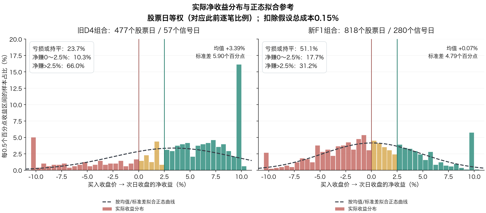
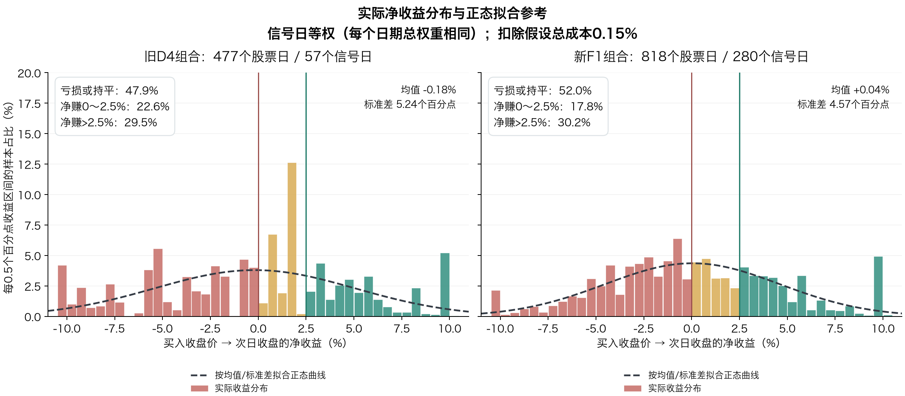

# 实际收益分布与“红盘率、达标率”的区别

2026-10-25。来源为旧D4的477个股票日与新F1每日最多5只所选818个股票日，两者是不同条件和样本。用同一公式重算：

`净收益 = (T+1收盘 / T收盘 − 1)×100% − 0.15%`

成本是统一研究假设，入场价为收盘代理；F1此前另做过14:50/14:55固定候选价格检查。本说明只比较同一收盘代理口径，不把不同入场时点混合。

## 先纠正容易混淆的比较

之前的81.55%是旧D4样本“次日收盘>次日开盘”的阳线比例，不是新F1的红盘率。新F1次日收阳只有50.00%。同样叫“红”，若分母、样本不同就不能直接比较。

| 指标 | 旧D4：477笔/57日 | 新F1：818笔/280日 |
|---|---:|---:|
| 次日阳线：次日收盘>次日开盘 | 81.55% | 50.00% |
| 次日相对昨收收涨：次日收盘>T收盘 | 76.73% | 49.51% |
| 买入后扣费盈利：净收益>0% | 76.31% | 48.90% |
| 买入后扣费赚超2.5% | 66.04% | 31.17% |

K线阳线的参考价是次日开盘，持仓盈亏的参考价是前一天买价；低开后收阳也可能持仓亏钱。扣费盈利与赚超过2.5%又是两个不同门槛。

## 实际收益直方图

- 横轴是净收益，纵轴是每0.5个百分点区间内的样本比例，不是累计概率。
- 红色柱表示亏损或持平区域，黄色为小幅盈利区域，绿色为净收益超过2.5%的区域。
- 黑色虚线按同一批样本的均值和总体标准差拟合正态曲线，并按直方图区间宽度缩放，便于比较。
- 虚线是参照，不代表收益已被证实服从正态分布，也不用于预测下一笔交易。约±10%附近的聚集、偏斜和尾部形状，应以实际柱形和计数为准。
- 全部实际收益都在图的横轴范围内，最高区间的柱也完整展示，没有截去涨跌停附近的样本。

### 三段拆分

| 净收益区间 | 旧D4 | 新F1 |
|---|---:|---:|
| ≤0%：亏损或持平 | 113/477＝23.69% | 418/818＝51.10% |
| >0%且≤2.5%：赚钱但未达标 | 49/477＝10.27% | 145/818＝17.73% |
| >2.5%：严格达标 | 315/477＝66.04% | 255/818＝31.17% |

新F1一共400笔扣费赚钱，其中145笔只赚0～2.5%，未达到目标；另外418笔亏损或持平。所以它的31.17%达标率，并不是“八成赚钱但都赚得小”，而是这组新样本本身只有48.90%扣费盈利。

## 更细的分布

| 净收益区间 | 旧D4：数量/比例 | 新F1：数量/比例 |
|---|---:|---:|
| ≤−7.5% | 42 / 8.81% | 41 / 5.01% |
| (−7.5%,−5%] | 20 / 4.19% | 80 / 9.78% |
| (−5%,−2.5%] | 23 / 4.82% | 128 / 15.65% |
| (−2.5%,0%] | 28 / 5.87% | 169 / 20.66% |
| (0%,1%] | 18 / 3.77% | 71 / 8.68% |
| (1%,2.5%] | 31 / 6.50% | 74 / 9.05% |
| (2.5%,5%] | 86 / 18.03% | 131 / 16.01% |
| (5%,7.5%] | 89 / 18.66% | 59 / 7.21% |
| >7.5% | 140 / 29.35% | 65 / 7.95% |

表内右端点包含，2.5%不计入达标。百分比四舍五入可能存在0.01个百分点的合计误差。

### 分位数和离散程度

| 描述统计 | 旧D4 | 新F1 |
|---|---:|---:|
| 平均净收益 | +3.39% | +0.07% |
| 总体标准差 | 5.90个百分点 | 4.79个百分点 |
| 最差值 | −10.20% | −10.19% |
| 5%分位 | −9.94% | −7.46% |
| 25%分位 | +0.46% | −3.18% |
| 中位数 | +4.79% | −0.15% |
| 75%分位 | +8.07% | +3.30% |
| 95%分位 | +9.86% | +9.81% |
| 最好值 | +10.11% | +10.44% |

例如，新F1中间50%的逐笔净收益落在约−3.18%至+3.30%，一半样本不超过−0.15%。均值接近0，正负波动却较大。

若机械使用拟合正态曲线，旧D4的“>2.5%”面积约56.00%，与实际66.04%差别明显；新F1拟合面积约30.57%，接近实际31.17%。一个门槛上的比例接近，不等于整个分布或尾部风险都服从正态分布。本轮没有在有日期相关性的股票样本上用独立同分布假设做正态性显著性结论。

## 少数密集日期会怎样改变分布

本图保留同一批逐笔收益，只改变权重：每个信号日期分配相同总权重，再由当天股票均分。因此仍是逐笔收益的加权分布，**不是先把每天收益平均后得到的组合日收益分布**，也没有重新每天限选5只。

| 按信号日等权后的指标 | 旧D4 | 新F1 |
|---|---:|---:|
| 平均净收益 | −0.18% | +0.04% |
| 扣费盈利比例 | 52.13% | 48.04% |
| 净收益>2.5%比例 | 29.53% | 30.21% |

旧D4的股票日等权分布明显偏向盈利一侧，重新按日期等权后改变很大；这与此前发现其结果集中于少数反弹日一致。F1本来每天最多5只，重新按日期等权后的变化较小。

## 2026单独查看

| 指标 | 旧D4：245笔/35日 | 新F1：458笔/129日 |
|---|---:|---:|
| 次日收阳率 | 76.33% | 44.98% |
| 相对昨收收涨率 | 78.78% | 46.07% |
| 扣费盈利比例 | 78.37% | 45.41% |
| 净收益>2.5%比例 | 66.53% | 29.04% |
| 平均逐笔净收益 | +3.16% | −0.28% |
| 按日期等权平均净收益 | −0.54% | −0.39% |

原样本、选样偏差、不复权价格及实际交易执行方面的限制，继续沿用前两份研究报告。

## 文件与核验

完整机器统计为`distribution-summary.json`，分段计数为`收益分段统计.csv`，逐笔数据为`逐笔收益明细.csv`。图中正态密度乘以0.5个百分点区间宽度后转为百分比，与柱形采用相同尺度。

脚本为`scripts/research/oversold-target-20261025/distribution.py`。已核对每组分段数量总和、三段百分比合计100%、无重复股票日，以及旧D4的315/477与新F1的255/818严格达标数，与之前结果一致。
