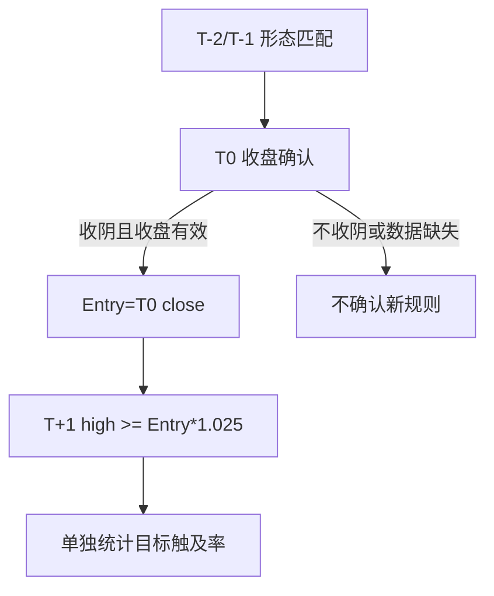
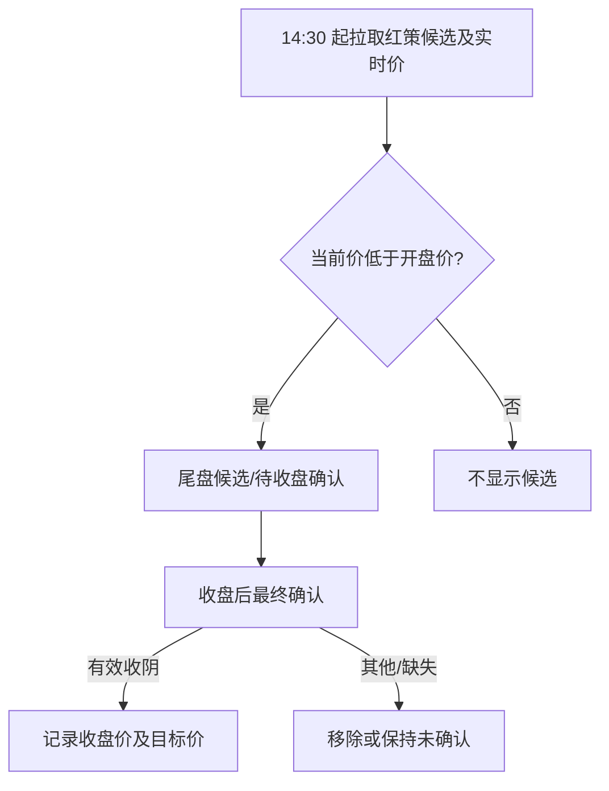
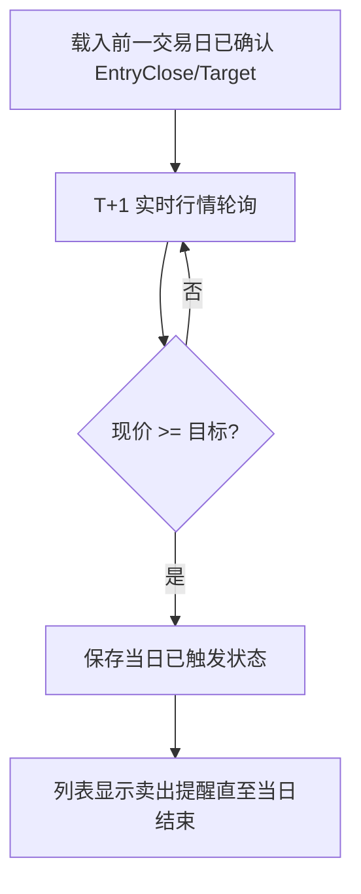

# 小阴收盘买入与目标触发提醒实现计划

**设计文档：** `docs/superpowers/T0策略/2026-10-08-小阴收盘买入目标触发提醒-设计.md`
**先行测试契约：** `docs/superpowers/T0策略/2026-10-08-小阴收盘买入目标触发提醒-测试用例.md`

## 目标 / 架构 / 技术栈 / 全局约束

- 当前分支为 `codex/t0-red-rule-explanations`，继续在该功能分支工作；保留所有既有未提交文件。
- 新规则独立 key/version；旧规则统计和已有红策列表流程不得回归。
- 使用已有 Go 测试、Flutter 测试及实时行情批量接口；不新增依赖。
- 目标触发只生成提醒，不发委托。

## 模块与接口

- Go 红策规则和回放：前置形态、T0 收阴/收盘入场、T+1 目标触及统计。
- Flutter 红策列表与 ViewModel：14:30 尾盘候选轮询、收盘确认、T+1 实时监控及提醒状态。

## 开发依赖

Task 1 完成后可验证规则与统计；Task 2 后可在列表查看尾盘候选；Task 3 完成后形成完整提醒闭环。

### 任务 1：新增独立收盘入场规则与回放口径

#### 流程图



#### 伪代码

```text
保留旧规则
对新规则按独立 key/version 生成 T0 收盘入场样本
若 T0 close >= T0 open 或 T0/T+1 数据缺失则跳过该样本
目标价按 T0 close*1.025 向上取到分；用 T+1 high >= 目标价统计触及
```

#### 注意点

- 不修改旧规则共用的开盘入场字段含义；需要新字段表达收盘价与目标价。
- 验证规则-RULE-001/002、统计-STAT-001。

**Files:** `backend/flutter_api/t0_red_gob_rules.go`、`backend/flutter_api/t0_red_stats.go`、`backend/flutter_api/t0_red_strategy_test.go`。
**Interfaces:** 新规则 hit 中的收盘入场/目标字段，供 API JSON 与 Flutter 共用。

- [ ] 先写失败测试：规则-RULE-001、规则-RULE-002、统计-STAT-001
- [ ] 确认失败原因是功能缺失
- [ ] 最小实现
- [ ] 定向测试 / 回归 / 差异审查

### 任务 2：14:30 尾盘候选与收盘确认

#### 流程图



#### 伪代码

```text
上海时间 14:30～收盘：按小批量复用现有行情请求轮询候选
现价 < 开盘价时展示待确认行
收盘后仅用有效收盘价确认 T0 收阴并记录 EntryClose/TargetPrice
```

#### 注意点

- 14:30 结果只作为候选；不得提前标成正式买入。
- 行情接口失败保留待确认状态。
- 验证页面-UI-001/002。

**Files:** `trading_app/lib/features/radar/presentation/radar_list/t0_strategy_view_model.dart`、`trading_app/lib/features/radar/presentation/radar_list/radar_page.dart`。
**Interfaces:** 新候选/收盘入场状态透过红策 ViewModel 提供给列表卡片。

- [ ] 先写失败测试：页面-UI-001、页面-UI-002
- [ ] 确认失败原因是功能缺失
- [ ] 最小实现
- [ ] 定向测试 / 回归 / 差异审查

### 任务 3：T+1 目标触发及持续提醒

#### 流程图



#### 伪代码

```text
载入本地已确认且属于上一交易日的目标监控项
轮询现价；首次到达目标时记录当日触发
行情回落不清除触发状态；跨日清理过期项目
```

#### 注意点

- 触发按实时报价现价判断；10 秒轮询不能保证观察到两次轮询之间的瞬时触及。
- 本地状态不代表服务器下单或其他设备同步。
- 验证提醒-ALERT-001/002。

**Files:** `trading_app/lib/features/radar/presentation/radar_list/t0_strategy_view_model.dart`、`trading_app/lib/features/radar/presentation/radar_list/radar_page.dart`、`trading_app/test/features/radar/t0_strategy_view_model_test.dart`。
**Interfaces:** 持久化的目标监控项供 T+1 红策列表加载与报价更新使用。

- [ ] 先写失败测试：提醒-ALERT-001、提醒-ALERT-002
- [ ] 确认失败原因是功能缺失
- [ ] 最小实现
- [ ] 定向测试 / 回归 / 差异审查
